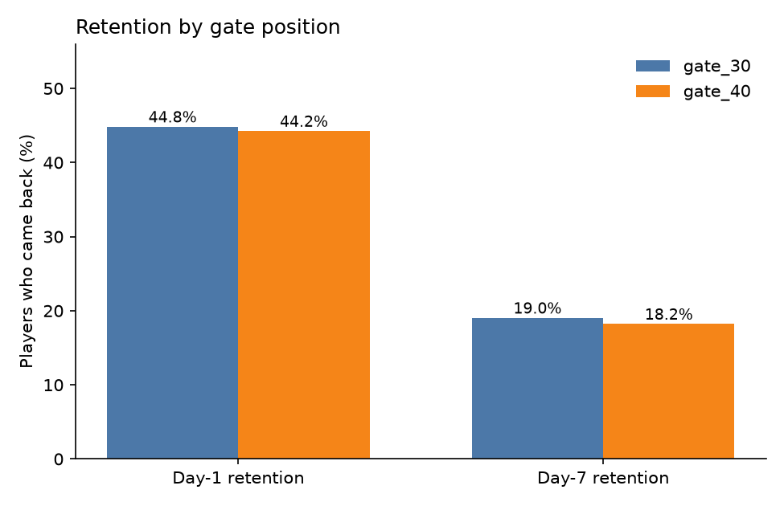
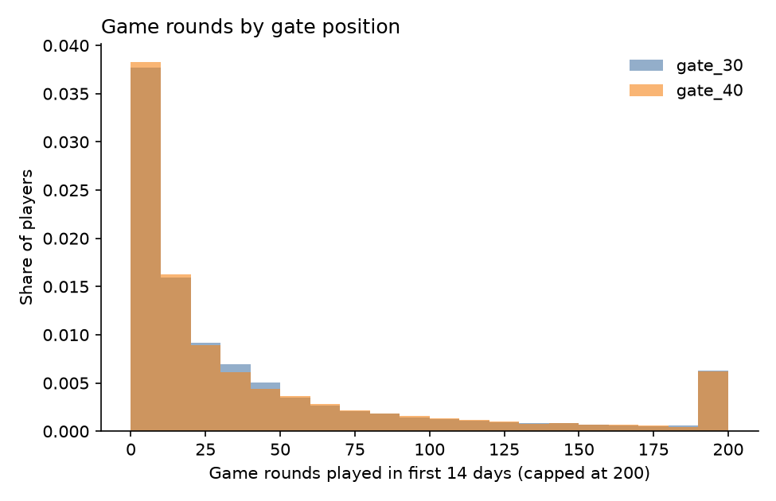

# Mobile Game A/B Test: Cookie Cats (Python)

**Question:** The game *Cookie Cats* moved its first progress gate from level 30 to level 40. Did that change how many players come back after 1 day and after 7 days?

## Data
- Dataset: [Mobile Games A/B Testing - Cookie Cats](https://www.kaggle.com/datasets/mursideyarkin/mobile-games-ab-testing-cookie-cats) (Kaggle)
- 90,189 players, randomly assigned to `gate_30` (control, 44,700 players) or `gate_40` (test, 45,489 players).
- Columns: `userid`, `version`, `sum_gamerounds` (rounds played in the first 14 days), `retention_1` and `retention_7` (came back on day 1 and day 7).
- Checks: no duplicate players, no missing values, groups of similar size.

## Method
- Python (pandas, numpy, matplotlib).
- Compared retention between the two versions with a two-proportion z-test and a bootstrap 95% interval for the difference.
- Checked the game-rounds data for outliers (one player had 49,854 rounds) and removed the top 0.1% for the rounds comparison only.
- Looked at how day-7 retention changes with player activity.

## Results

| Metric | gate_30 | gate_40 | Difference | p-value | Significant? |
|---|---|---|---|---|---|
| Day-1 retention | 44.82% | 44.23% | -0.59 pts | 0.0744 | No |
| Day-7 retention | 19.02% | 18.20% | -0.82 pts (95% interval -1.32 to -0.31) | 0.0016 | **Yes** |

- Moving the gate to level 40 did **not** improve retention. Day-7 retention was **0.82 percentage points lower** (about 4% lower in relative terms), and the difference is statistically significant.
- Engagement is the strongest signal of who comes back: day-7 retention is 0.7% for players with 0 rounds, 11.4% for 11-50 rounds, and **71.3%** for players with 100+ rounds.
- 4.4% of players installed the game and never played a round.




## Recommendation
**Keep the first gate at level 30.** The test version did not help day-1 retention and reduced day-7 retention. A longer wait before the gate seems to cost some players who would otherwise have returned.

Next steps I would take:
1. Test a different change aimed at the first sessions, since players with very few rounds almost never return.
2. Measure revenue and ad impressions, not only retention, before making a final decision.

## Limitations
- The effect is small (under 1 percentage point), so the result is clear but modest in size.
- The data covers only the first 14 days and only retention, not revenue.
- I assume players were randomly assigned, as the dataset describes. Results are only as reliable as that assignment.

## How to run
```
pip3 install pandas numpy matplotlib
python3 cookie_cats_ab_test.py /path/to/cookie_cats.csv
```
The script saves charts and `results.txt` to a folder called `ab_output`. The CSV is not included; download it from the Kaggle link above.

## Tools
Python, pandas, numpy, matplotlib, statistical testing (z-test, bootstrap)
